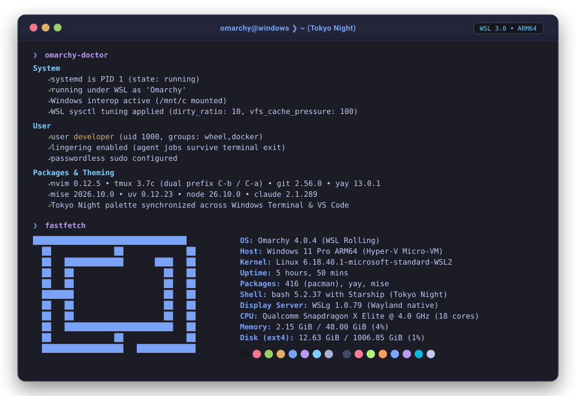
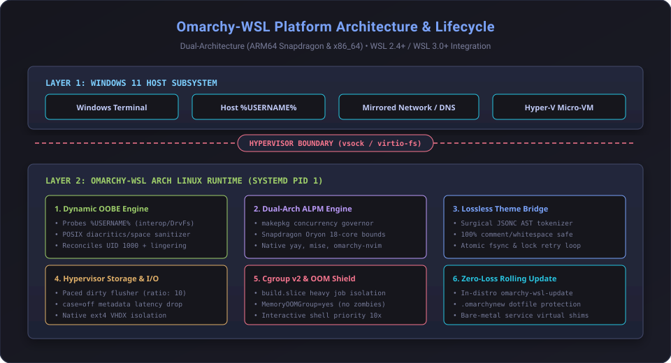

# Omarchy-WSL 🌌

[](LICENSE)
[](#dual-architecture-alpm-engine)
[](#wsl3--hypervisor-optimizations)
[](#adversarial-test-suites)

The bleeding-edge, dual-architecture Arch Linux distribution engine purpose-built for the **Windows Subsystem for Linux (WSL2 & WSL 3.0+)**.

Brings the authentic **[Omarchy](https://omarchy.org)** developer workstation experience—Tokyo Night theming, Neovim (LazyVim), dual-prefix tmux, Starship prompt, `btop`, `eza`, `bat`, `fzf`, `yay`, and `mise`—to Windows with zero desktop baggage and deep hypervisor tuning.

<p align="center">
  
</p>

---

## ⚡ Quickstart (One-Line Install)

Run in a standard **PowerShell** prompt (as your normal Windows user, *do not run as Administrator*):

```powershell
irm https://raw.githubusercontent.com/chntllh-labs/omarchy-wsl/main/install/install.ps1 | iex
```

Once installed, launch it from Windows Terminal, your Start Menu shortcut, or by running:
```powershell
wsl -d Omarchy
```

---

## 🚀 Key Architectural Pillars

### 1. Dynamic First-Boot OOBE & Zero Hardcoding
Unlike legacy community WSL packages that hardcode usernames (e.g. `omarchy` or `ubuntu`), Omarchy-WSL ships with an adversarial **Out-Of-Box Experience (OOBE) engine**:
- **Automatic Host Detection:** Discovers your Windows `%USERNAME%` across Windows interop or DrvFs inspection.
- **POSIX Sanitization:** Automatically transliterates Latin diacritics (`François` → `francois`, `Müller` → `m_uller`), converts spaces/symbols (`John Doe` → `john_doe`), prepends invalid leading characters (`123agent` → `u_123agent`), and clamps to 31 characters.
- **UID 1000 Reconciler:** Seamlessly renames stock rootfs accounts (e.g. Arch Linux ARM's `alarm`) to your user with passwordless `sudo` and systemd user lingering (`loginctl enable-linger`).
- **Headless-Safe:** Automated commands (`wsl -d Omarchy -- whoami` or CI runners) bypass prompts without hanging.

### 2. Dual-Architecture ALPM Engine (Qualcomm Snapdragon ARM64 & AMD64)
First-class support for ARM64 (Qualcomm Snapdragon X Elite / Plus dev kits and laptops) alongside standard x86_64:
- **Algorithmic Compiler Governor (`scripts/makepkg-governor.sh`):** Prevents 12–18 core processors from triggering Linux OOM panics during heavy C++/Rust builds by scaling `-j` concurrency strictly to available RAM ($\min(\text{nproc}, \lfloor \text{RAM} / \text{weight} \rfloor)$).
- **Binary ALPM Repository:** Upstream Omarchy packages (`omarchy-nvim`, `yay-bin`, `mise-bin`, `omarchy-wsl-keyring`) pre-indexed in an ALPM repository for atomic, fast updates.

### 3. Lossless Cross-OS Theme Sync
Omarchy's theme engine bridges the virtualization boundary to theme your host Windows environment:
- **Windows Terminal Sync:** Custom lossless JSONC AST engine modifies `settings.json` schemes surgically with `fsync` and Windows sharing-lock exponential retries, preserving **100% of user comments, whitespace, and custom keybindings**.
- **VS Code Integration:** Injects matching `terminal.ansi*` colors into `workbench.colorCustomizations`.
- **Multi-Variant Detection:** Automatically discovers Windows Terminal Stable (MSIX), Preview, Canary, and Unpackaged installations.

### 4. High-Core Virtualization & Storage Tuning
- **Kernel Writeback Pacing:** Eliminates synchronous writeout freezes (`throttle_vm_writeout()`) during multi-threaded builds by tuning `vm.dirty_background_ratio = 5`, `vm.dirty_ratio = 10`, and `dirty_writeback_centisecs = 250`.
- **Metadata Latency Elimination:** Enforces `case=off` and `metadata,uid=1000,gid=1000,umask=022,fmask=011` on DrvFs mounts, eliminating redundant NTFS per-directory attribute walks.
- **Data Corruption Protection:** Disables experimental `sparseVhd=true` in host templates to prevent ext4 superblock/journal corruption from concurrent NTFS hole-punching races.

### 5. Enterprise Network & Corporate Proxy Resiliency
- **Mirrored Networking (`networkingMode=mirrored`):** Automatically enables low-latency mirrored networking on Windows 11 22H2+ while providing fallback to NAT on Windows 10.
- **DNS Tunneling Coexistence:** Neutralizes the `systemd-resolved` tug-of-war via `omarchy-dns-sync` and disables DNSSEC downgrades that fail under corporate SSL inspection proxies.
- **Corporate Root CA Sync (`omarchy-ca-sync`):** Automatically extracts Windows Enterprise Root CAs from the Windows Certificate Store into Arch Linux trust anchors (`/etc/ca-certificates/trust-source/anchors/`).
- **Container Bridge Isolation:** Clamps Docker/Podman MTUs to 1420 for VPN compatibility and isolates default subnet pools to RFC 2544 benchmark space (`198.18.0.0/16`).

### 6. Zero-Data-Loss In-Distro Updates
Never wipe your `/home` partition to update. Running:
```bash
omarchy-wsl-update
```
performs an in-place rolling update:
- Updates Arch packages via `pacman -Syu`.
- Pulls upstream Omarchy CLI improvements.
- Uses `.omarchynew` divergence handling (Arch `.pacnew` convention) so custom dotfiles are never overwritten.
- Intercepts bare-metal system calls (SDDM, Limine, Plymouth) with transparent virtualization shims.

---

## 🛠️ Building from Source

Build the compressed, clean `.wsl` distribution package using modern multi-stage containers:

### Prerequisites
- Windows 11 (Build 22621+ or 26100+)
- WSL2 enabled with `wslc.exe` or Docker Desktop

### Build Commands
```powershell
# Clone repository
git clone https://github.com/chntllh-labs/omarchy-wsl.git
cd omarchy-wsl

# Build using multi-stage container pipeline
docker build -t omarchy:dist -f Containerfile .

# Export compressed, sanitized rootfs bundle (~620 MB)
./scripts/build-reproducible-rootfs.sh
```

---

## 🧪 Adversarial Test Suites

Omarchy-WSL is validated through 4 automated test harnesses covering 81 gates:

| Test Suite | Coverage | Command | Result |
| :--- | :--- | :--- | :--- |
| **OOBE Suite** | Sanitization, collision handling, INI updates, sudoers validation | `bash tests/test_oobe_adversarial.sh` | **34/34 Passed** |
| **Networking Suite** | Mirrored mode, DNS tunneling, CA sync, MTU clamping, proxy rules | `bash tests/test_networking_adversarial.sh` | **20/20 Passed** |
| **Theme Engine Suite** | JSONC AST tokenization, comment preservation, atomic `fsync` | `bash tests/test_theme_adversarial.sh` | **27/27 Passed** |
| **Memory & Sysctl Suite** | Hardware scaling formulas, `build.slice` cgroup v2, writeback | `python3 tests/test_memory_governance.py` | **18/18 Passed** |

Run all tests:
```bash
PYTHONPATH=lib python3 -m unittest discover -s tests -p "test_*.py"
bash tests/test_oobe_adversarial.sh
bash tests/test_networking_adversarial.sh
bash tests/test_theme_adversarial.sh
```

---

## 📂 Project Architecture

<p align="center">
  
</p>

```
omarchy-wsl/
├── bin/
│   ├── omarchy-build          # Memory-bounded cgroup v2 compiler runner
│   ├── omarchy-ca-sync        # Windows Enterprise Root CA extractor
│   ├── omarchy-dns-sync       # DNS tunneling & systemd-resolved bridge
│   ├── omarchy-mirror-sync    # Ping-less pacman mirror benchmark CLI
│   ├── omarchy-netdoctor      # Full network audit and auto-repair utility
│   ├── omarchy-proxy-sync     # WinINet proxy environment synchronizer
│   ├── omarchy-theme-sync     # Cross-OS theme propagation CLI
│   └── omarchy-wsl-update     # In-distro zero-data-loss rolling updater
├── docs/                      # Comprehensive architectural specifications
│   ├── DUAL-ARCH-PACKAGE-ENGINE-SPEC.md
│   ├── OOBE-SPECIFICATION.md
│   ├── THEME-ENGINE.md
│   ├── WSL-NETWORKING-AND-DNS-ADVERSARIAL-REVIEW.md
│   └── storage-io-architecture.md
├── install/
│   └── install.ps1            # Production PowerShell one-command installer
├── lib/
│   ├── omarchy_theme/         # Lossless JSONC AST engine & terminal adapters
│   └── omarchy-wsl-migration-gate # Upstream migration virtualization shims
├── scripts/
│   ├── build-binary-repo.sh   # Dual-arch ALPM repository automation
│   ├── makepkg-governor.sh    # Hardware-topology-aware compiler governor
│   └── strip-rootfs.sh        # Zero-leak rootfs sanitization engine
├── tools/
│   └── generate-wslconfig.ps1 # Adaptive host .wslconfig generator
├── wsl/
│   ├── oobe.sh                # Dynamic first-boot provisioning engine
│   ├── pacman-init.sh         # Offline pacman keyring initializer
│   ├── wsl.conf               # Neutral base virtualization configuration
│   └── wsl-distribution.conf  # Modern WSL registration metadata
└── Containerfile              # 5-stage dual-arch reproducible container definition
```

---

## 📜 License

Distributed under the [MIT License](LICENSE). Upstream Omarchy components are copyright © [Basecamp](https://github.com/basecamp/omarchy).
