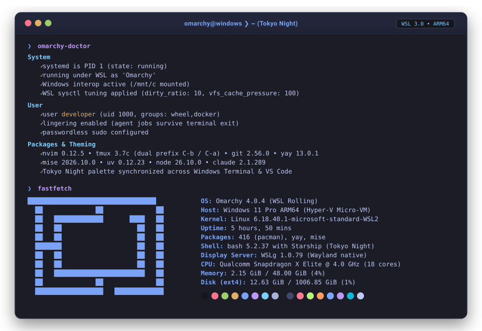

# Omarchy WSL

[](LICENSE)
[](https://github.com/chntllh-labs/omarchy-wsl/actions/workflows/ci.yml)
[](upstream.lock)
[](#building-from-source)

[Omarchy](https://omarchy.org) (Basecamp's Arch Linux setup) as a Windows
Subsystem for Linux distribution: upstream's command suite, themes and
defaults, Neovim (LazyVim), tmux, starship, btop, mise and yay. The Hyprland
desktop is left out; Windows supplies the desktop, and a set of Windows
bridges connects the two. Built for arm64 (Snapdragon and other ARM64 PCs) and
x86_64.

<p align="center">
  
</p>

## Install

From PowerShell, as your normal (non-administrator) Windows user:

```powershell
irm https://raw.githubusercontent.com/chntllh-labs/omarchy-wsl/main/install/install.ps1 | iex
```

The installer picks `Omarchy-arm64.wsl` or `Omarchy-x86_64.wsl` from the latest
release, checks it against the release's `SHA256SUMS` and runs
`wsl --install --from-file`. To install by hand, download the file for your CPU
from [Releases](https://github.com/chntllh-labs/omarchy-wsl/releases) and run:

```powershell
wsl --install --from-file .\Omarchy-arm64.wsl
```

Every release asset carries GitHub build provenance, and `SHA256SUMS` is signed
with Sigstore:

```bash
gh attestation verify Omarchy-arm64.wsl --repo chntllh-labs/omarchy-wsl
cosign verify-blob --bundle SHA256SUMS.sigstore.json \
  --certificate-identity-regexp 'https://github.com/chntllh-labs/omarchy-wsl/.github/workflows/release.yml@refs/tags/v.*' \
  --certificate-oidc-issuer https://token.actions.githubusercontent.com SHA256SUMS
```

## First launch

WSL runs `/usr/lib/wsl/oobe.sh` as root. It suggests a Linux user name derived
from your Windows user name, then creates that account with uid 1000 and
passwordless `sudo` for that account only (`--require-password` makes sudo ask).
It also enables lingering, so tmux and user services survive closed terminals,
and sets the account as the default WSL user. Without a terminal (for example
`wsl -d Omarchy -- cmd`) it runs unattended. A distribution imported with
`wsl --import` skips WSL's OOBE; the same provisioning then runs on the first
interactive root login (`/etc/profile.d/00-omarchy-firstboot.sh`).
[docs/OOBE-SPECIFICATION.md](docs/OOBE-SPECIFICATION.md) has the details.
`omarchy-rename-owner` renames the uid-1000 account later.

The Start menu entry and the Windows Terminal profile (Omarchy Tokyo Night
colours) come from `/etc/wsl-distribution.conf`.

## What is inside

| | |
|---|---|
| Omarchy | `bin/ default/ config/ install/ migrations/ themes/` of Basecamp Omarchy **v4.5.0** (commit pinned in [`upstream.lock`](upstream.lock)) in `/usr/share/omarchy`, every `omarchy-*` command on `PATH` |
| From Omarchy's signed `[omarchy]` repository | `omarchy-keyring`, `omarchy-nvim` (LazyVim with plugins prefetched), `yay`, `mise-bin`, JetBrains Mono Nerd Font |
| WSL overlay | `omarchy update`, `omarchy doctor`, `omarchy theme set` (themes the shell, tmux, btop and Neovim, plus Windows Terminal and VS Code through `omarchy-theme-bridge`), `omarchy version`; tmux with Ctrl-b and Ctrl-a prefixes |
| Windows bridges | `omarchy-open`, `omarchy-clip` (text, PNG, OSC 52), `omarchy-notify` (toasts), `omarchy-sync-dirs`, SSH/GPG agent and Git credential bridges, `omarchy-docker-bridge`, `omarchy-watch-bridge`, `omarchy-power-governor`; see [docs/WINDOWS-INTEGRATION-QOL.md](docs/WINDOWS-INTEGRATION-QOL.md) |
| Networking tools | `omarchy-netdoctor`, `omarchy-dns-sync`, `omarchy-ca-sync`, `omarchy-proxy-sync`, `omarchy-mirror-sync`; see [docs/WSL-NETWORKING-AND-DNS-ADVERSARIAL-REVIEW.md](docs/WSL-NETWORKING-AND-DNS-ADVERSARIAL-REVIEW.md) |
| Builds | `omarchy-build` runs a command in a resource-weighted cgroup slice with a RAM- and power-aware `-j` |
| Multi-tenant | `omarchy-tenant` runs isolated guests (systemd-nspawn, user namespaces, slirp4netns, cgroup egress filters, userspace Tailscale, key-only sshd); see [docs/MULTI-TENANT-ISOLATION.md](docs/MULTI-TENANT-ISOLATION.md) |
| Toolchains | gcc, make, Node.js, Python, uv, Lua; Docker (socket-activated). Heavier toolchains and `claude-code` are one command away: `packages/omarchy-wsl-extras.packages` |

`omarchy doctor` checks the install: systemd, interop, DNS, the owner account,
the pacman keyring and the pinned Omarchy key, `[omarchy]` wiring, the WSL
integration files and the integrity of every file this repository installed.

## Updating

```bash
omarchy update                 # pacman -Syu, migrations, mise, Neovim plugins, hooks
omarchy-wsl-update --check     # trust, repository wiring and pending updates; changes nothing
omarchy-wsl-update --self      # rebuild the omarchy-wsl package from the newest release tag
```

`omarchy update` never edits `pacman.conf`. It refuses to run when the pinned
Omarchy signing key is missing, and `--repair-pacman` restores the shipped
configuration with backups.

## Headless and always-on hosts

```powershell
# .wslconfig for a server: keep the VM and the distribution running with no session attached
.\tools\generate-wslconfig.ps1 -Profile Server -DryRun     # review the merged result
.\tools\generate-wslconfig.ps1 -Profile Server -Force
# start the distribution at logon (or at boot, see the script's help)
.\tools\register-wsl-autostart.ps1 -Distro Omarchy
```

The Server profile sets both `[wsl2] vmIdleTimeout=-1` and
`[general] instanceIdleTimeout=-1`; without the second key WSL stops the
distribution about 15 seconds after the last session ends. The generator merges
into an existing `.wslconfig` instead of replacing it. Inside the distribution
these scripts are also available under `/usr/share/omarchy-wsl/windows/`.

## Building from source

Builds run on Linux with Docker or Podman: natively on arm64 or x86_64, or in
GitHub Actions. Never pack or unpack the root filesystem on macOS, because
bsdtar drops setuid bits, system uids and file capabilities. The script handles
the archive inside a Linux container either way.

```bash
scripts/build-reproducible-rootfs.sh arm64 --verify-determinism --self-test-leak
scripts/smoke-test-image.sh dist/Omarchy-arm64.wsl
```

The Stage 0 root filesystem (Arch Linux ARM, or the Arch Linux bootstrap for
x86_64) is fetched over HTTPS and its signature checked against a key vendored
in `wsl/keys/`. The build then trusts the pinned Omarchy key before its first
sync, installs from `[omarchy]` without AUR builds, builds the `omarchy-wsl`
package from the pinned upstream commit, and verifies the result (theme
overlay against upstream, units through `systemd-analyze`, a gcc link, WSL's
1 MiB limits). Before writing the `.wsl`, it audits the exact tree for leaked
credentials and machine identity, then archives it deterministically: two
normalisations of one export are byte-identical. The archive must stay under
800 MiB.

[docs/DUAL-ARCH-PACKAGE-ENGINE-SPEC.md](docs/DUAL-ARCH-PACKAGE-ENGINE-SPEC.md)
describes every step. `make install-rootfs DESTDIR=/tmp/root` installs this
repository's files into any directory; [`rootfs.manifest`](rootfs.manifest) is
the single list.

## Tests

```bash
make test             # tests/run-all.sh on this machine
make test-container   # the same inside tests/ci/Containerfile (bash 5, GNU tools, pytest, pwsh)
```

`tests/run-all.sh` runs shellcheck, a PowerShell parse of every script, pytest
and every `tests/test_*.sh` suite. It is strict: a skipped check (a missing
tool, an unreachable input) counts as a failure. CI runs it on arm64 and x86_64
for every pull request. The release workflow also builds both images and gates
them with the archive checks and `scripts/smoke-test-image.sh`.

## Repository layout

```
bin/                 user commands (installed to /usr/bin)
wsl/overlay/bin/     WSL replacements for upstream commands
wsl/bin/             Windows bridges (/usr/lib/omarchy-wsl/bin)
lib/                 shared shell libraries, migration gate, Python theme engine
wsl/                 OOBE, wsl.conf, wsl-distribution.conf, profile.d, systemd units,
                     cgroups, sysctl, pacman templates, skel, vendored keys
tools/               theme bridge, Windows-side PowerShell (wslconfig, autostart, Explorer)
packages/            package sets and the omarchy-wsl PKGBUILD
build/               image build steps (Containerfile)
scripts/             export/normalise/audit, manifest installer, smoke test, upstream bump
tests/               suites, fixtures, the CI test environment
install/install.ps1  Windows installer
distributions/       Microsoft DistributionInfo.json entry
upstream.lock        every pinned external input
rootfs.manifest      every file this repository installs
```

## License

MIT, see [LICENSE](LICENSE). Omarchy is copyright Basecamp and MIT-licensed;
its license ships as `/usr/share/licenses/omarchy-wsl/LICENSE.omarchy`.
